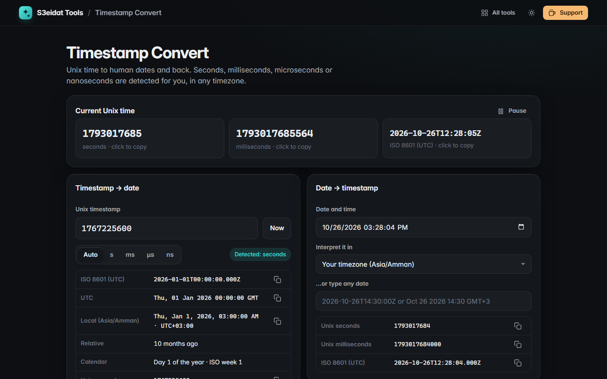

# Timestamp Convert

> Unix time to dates and back, in any timezone. Free, private, and it runs entirely in your browser.

### ▶ [Open Timestamp Convert](https://s3eidat.github.io/timestamp-convert/)



## Features

- **Live current Unix time** in seconds and milliseconds, plus ISO 8601; click any value to copy, pause to freeze it
- **Timestamp → date** with the unit **auto-detected** (seconds, milliseconds, microseconds, nanoseconds) or forced;
  big µs/ns values are parsed exactly with `BigInt`. Negative timestamps (before 1970) work too
- Shows **ISO 8601**, **UTC**, **local time with offset**, **relative time** ("3 days ago"), day of year and **ISO week**
- **Around the world**: the same instant in any IANA timezone you add (your list is remembered), with UTC offsets
- **Date → timestamp**: pick a date and time and the timezone it is in (DST handled), or type any date string
- Copy buttons on every value

Timezone data comes from your browser's built-in `Intl` support; nothing is downloaded.

## Privacy

Nothing is sent anywhere. There is no server, no account, no analytics.
The page ships with a strict Content-Security-Policy (`connect-src 'self'`), so the browser
itself blocks any attempt to send data anywhere.

## Run it yourself

It's plain HTML, CSS and JavaScript with no build step:

```bash
git clone https://github.com/s3eidat/timestamp-convert
cd timestamp-convert
python -m http.server 8000
```

Then open http://localhost:8000.

## Support

If this saved you time, **[buy me a coffee ☕](https://s3eidat.github.io/coffee/)**. It keeps every tool free.

---

Part of **[S3eidat Tools](https://s3eidat.github.io/)**: 100+ free, private tools that run in your browser. MIT licensed.
